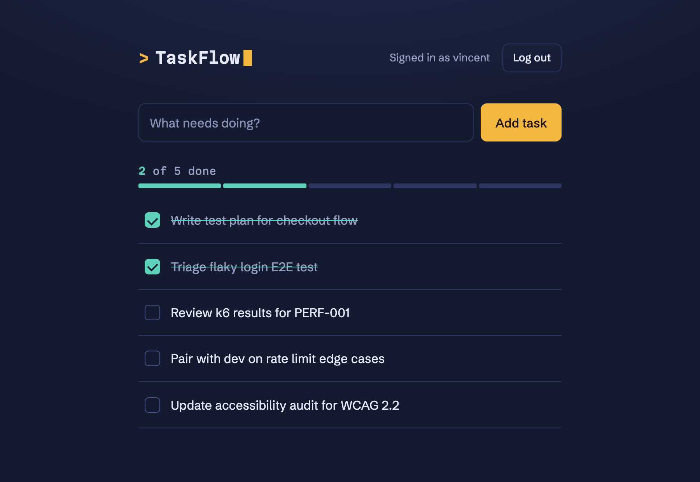

# TaskFlow, an app built to be tested

[](https://github.com/VincentJerico/taskflow-under-test/actions/workflows/ci.yml)


TaskFlow is a small task manager I built so I could test software I own from end to end. The app
is deliberately simple. The point is the testing around it: unit, API and E2E suites, plus a set
of bugs I planted on purpose and the tests that catch them.

It's a companion to my [QA Engineering Journey](https://github.com/VincentJerico/qa-engineering-journey).

<!-- After deploying, add your live URL here, e.g.:
**Live demo:** https://taskflow-under-test.onrender.com  (free tier, so the first load may be slow) -->



## Stack

The app is Node and Express with SQLite (better-sqlite3) and a single static HTML page for the UI.
Vitest runs the unit tests, Supertest the API tests and Playwright the E2E tests. GitHub Actions
runs all of them.

## Run

```bash
npm install
npm start          # http://localhost:3000
npm test           # unit + API tests
```

## API

Auth uses tokens. `POST /api/auth/login` returns a token, which you send as
`Authorization: Bearer <token>`. Every `/api/tasks` route needs a token and only works on the
signed-in user's own tasks.

| Method | Path                 | Auth | Description                                    |
| ------ | -------------------- | ---- | ---------------------------------------------- |
| GET    | `/health`            | no   | health check, returns `{ "status": "ok" }`     |
| POST   | `/api/auth/register` | no   | create account (400 missing fields, 409 taken) |
| POST   | `/api/auth/login`    | no   | returns `{ token }` (401 invalid credentials)  |
| POST   | `/api/auth/logout`   | yes  | invalidate current token (204)                 |
| GET    | `/api/tasks`         | yes  | list the user's tasks                          |
| GET    | `/api/tasks/:id`     | yes  | get one (404 missing, 403 not owner)           |
| POST   | `/api/tasks`         | yes  | create (400 invalid input)                     |
| PUT    | `/api/tasks/:id`     | yes  | full update (404, 403 or 400)                  |
| DELETE | `/api/tasks/:id`     | yes  | delete (204, or 404 or 403)                    |

The rules are simple. A title is required, status is one of `todo`, `doing` or `done`, `due_date`
is optional but must be a real `YYYY-MM-DD` date, and users can only reach their own tasks.

## Testing

Every layer runs in CI.

```bash
npm test              # unit + API (Vitest + Supertest)
npm run test:e2e      # E2E (Playwright starts the app itself)
```

- [docs/TEST-STRATEGY.md](docs/TEST-STRATEGY.md) explains the test pyramid, what each layer owns
  and the techniques used.
- [docs/BUGS-FOUND.md](docs/BUGS-FOUND.md) covers the 4 seeded bugs and the tests that caught them,
  plus a real stored XSS found in a later test audit.

## How it was built

I built it in seven milestones. The counts below are what each milestone added at the time.

1. Scaffold: app skeleton, SQLite, a tasks endpoint and green CI.
2. The app: register, log in and log out, full task CRUD, the business rules and access control.
3. Unit tests: 27 validator cases using equivalence partitioning and boundary values, including
   impossible dates.
4. API tests: 28 cases covering auth, the full CRUD lifecycle, 400/401/404 responses and the 403
   for another user's task.
5. E2E tests: Playwright journeys for the main flow, a failed login, a session that survives a
   reload, and adding and deleting tasks.
6. Seeded bugs: 4 planted bugs, each caught by a test (see [docs/BUGS-FOUND.md](docs/BUGS-FOUND.md)).
7. Docs: the test strategy, this README and the CI badge.

## Standards and tooling

- ESLint and Prettier, both enforced in CI (`npm run lint`, `npm run format:check`).
- Coverage with `npm run test:coverage`. The HTML report is at `coverage/index.html`.
- CI runs three parallel jobs on every push and PR: lint and format, unit and API tests with
  coverage, and E2E. Coverage is reported, not gated.
- [CONTRIBUTING](CONTRIBUTING.md), [SECURITY](SECURITY.md), issue and PR templates, Dependabot and
  an MIT [LICENSE](LICENSE).
- `.editorconfig` and `.node-version` keep environments consistent.

## Deployment

It runs on any host that keeps a Node process alive. A [Render](https://render.com) Blueprint
([`render.yaml`](render.yaml)) is included, and [DEPLOY.md](DEPLOY.md) walks through the steps.

## Project structure

```
taskflow-under-test/
├── src/
│   ├── app.js  server.js  db.js  auth.js  validators.js
│   ├── routes/      auth.js  tasks.js
│   └── middleware/  requireAuth.js
├── public/index.html          # auth + tasks UI (data-testid hooks for E2E)
├── tests/
│   ├── unit/     *.test.js (pure functions, no server)
│   ├── api/      smoke / auth / tasks
│   └── e2e/      journey.spec.js
├── docs/         TEST-STRATEGY.md  BUGS-FOUND.md
└── .github/workflows/ci.yml    # lint job · unit+API job · E2E job
```

The original plan is in the journey repo:
[TaskFlow project brief](https://github.com/VincentJerico/qa-engineering-journey/blob/main/10-projects/taskflow-under-test-plan.md).
